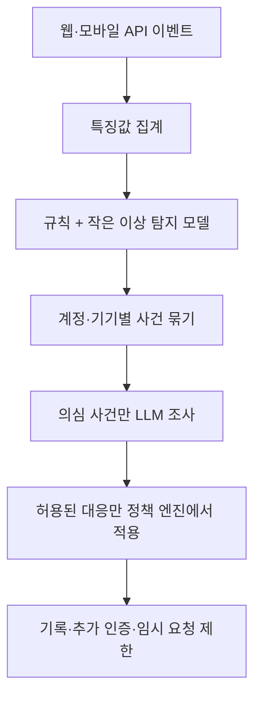

# AI 기반 로그인·계정 탈취 방어 서비스

> 아이디어 보관 단계. 구현·배포는 아직 시작하지 않음.

## 출발점

시스코의 AI 보안 사례를 읽으며 나온 질문: 대량의 로그와 패킷을 LLM이 전부 읽으면 토큰 비용과 지연이 너무 커지지 않을까? 웹·모바일 앱에서도 AI로 공격을 막는 과정을 직접 보여줄 수 있을까?

핵심 구상은 **모든 패킷을 읽는 챗봇이 아니라, 대량 선별기와 필요한 사건을 조사하는 AI 분석가를 결합하는 것**이다. 아래 설계는 일반적인 구현 아이디어이며, 시스코 제품의 내부 구조를 확인한 내용은 아니다.

## 기획

로그인·게시글·파일 다운로드 기능을 가진 작은 웹서비스에 정상 사용자와 공격 시나리오를 재현한다. 모바일 앱도 같은 API를 사용하도록 확장할 수 있다.

**보여줄 가치:** 탐지 → 근거 설명 → 추가 인증·임시 제한 → 효과 측정까지 한 흐름으로 시연한다.

### 테스트 시나리오

본인이 소유한 로컬 테스트 환경과 합성 계정·데이터만 사용한다.

- 여러 계정을 대상으로 로그인 반복 시도
- 로그인 성공 직후 낯선 기기에서 대량 다운로드
- 접근 권한이 없는 자료에 대한 반복 요청
- 정상 대량 다운로드나 사용자의 기기 변경도 포함해 오탐을 검증

권한 검증은 서버가 항상 수행한다. AI는 취약한 권한 검사를 대신하는 것이 아니라, 반복되는 악용 행동을 추가로 탐지한다.

## 설계 아이디어

### 1. 원본 로그를 특징값으로 변환

계정·IP·기기별 시간 창을 두고 로그인 실패 수, 접근 계정 수, 다운로드량, 새 기기 여부 등을 집계한다. IP 하나만으로 사용자를 단정하지 않으며, 비밀번호·인증 토큰은 수집하지 않는다.

패킷 전체 대신 연결·행동 통계를 사용한다. 암호화된 통신 내용은 임의로 볼 수 없으므로 서버가 관측 가능한 앱 이벤트를 중심으로 시작한다.

### 2. 규칙 + 작은 ML 모델로 선별

- 규칙: 반복 실패, 요청량 초과 등 명확한 패턴
- ML 후보: Isolation Forest를 이용한 이상 점수 계산
- 금융 FDS처럼 행동 특징을 통해 의심 대상을 선별하는 역할
- 이상 점수는 공격 확률이 아니므로 별도 검증과 임계값 조정 필요

이 단계의 일반적인 수치형 ML 추론은 LLM 토큰 과금 방식과 다르다. 연산·저장 비용은 별도로 존재한다.

### 3. 의심 사건만 LLM이 조사

동일 계정·기기의 경보를 묶고, 필요한 시간대의 이벤트만 조회한다. LLM은 증거를 연결해 판단 근거·추가 확인 사항·대응 권고를 구조화된 결과로 반환한다.

예: 로그인 실패 → 낯선 기기에서 로그인 성공 → 대량 다운로드가 하나의 공격 흐름인지 조사한다.

- 사건 단위 호출, 입력 크기·조회 횟수·토큰 예산 제한
- 중복 사건 통합과 결과 캐시
- 로그 내용은 신뢰할 수 없는 데이터로 취급하여 프롬프트 인젝션에 대비
- LLM 지연·실패 시에도 기본 인증·권한 검사·속도 제한은 정상 작동

### 4. 정책 엔진이 대응

LLM이 임의 코드를 실행하거나 차단 정책을 자유롭게 만들지 않게 한다. 검증된 출력과 고정된 정책을 통해 허용된 조치만 적용한다.

- 낮은 위험: 기록·관찰
- 중간 위험: 추가 인증 요구
- 높은 위험: 만료 시간이 있는 임시 요청 제한

초기에는 관찰 모드로 평가하고, 오탐 영향을 확인한 뒤 자동 대응 범위를 넓힌다.

## 화면 구상

- 정상·공격 이벤트 실시간 흐름
- 계정별 사건 묶음과 위험 점수
- 판단 근거 및 참조한 이벤트
- 추가 인증·임시 제한 적용 결과
- 탐지 성능, 오차단, 지연, LLM 사용량 대시보드

## 어떻게 효과를 입증할까

동일한 별도 평가 시나리오로 세 구성을 비교한다.

1. 규칙만 사용
2. 규칙 + ML
3. 규칙 + ML + LLM

평가 데이터는 모델 학습·임계값 조정 데이터와 분리하고, 정상 사용자 행동도 충분히 포함한다.

- 공격 탐지율과 경보 정밀도
- 정상 사용자 오차단율
- 탐지·대응 지연
- 사건당 LLM 호출 수와 입출력 토큰량
- 조사 근거의 정확성 및 분석 시간

LLM이 탐지율을 높이지 못하더라도 설명 품질이나 조사 시간을 개선했는지 구분해서 평가한다. 합성 시나리오에서의 성과를 실제 운영 환경의 방어 성능으로 일반화하지 않는다.

## MVP 범위와 기술 후보

1. 작은 API와 구조화된 이벤트 수집
2. 정상·공격 이벤트 재현기 및 규칙 기반 기준선
3. 특징값 집계와 이상 탐지 모델
4. 선택적 LLM 조사와 관찰용 대시보드
5. 제한된 대응 및 비교 평가

기술 후보: FastAPI, SQLite 또는 PostgreSQL, scikit-learn, 간단한 Streamlit 대시보드. Redis와 별도 모바일 클라이언트는 필요할 때 확장한다. 기술 선정은 미확정이다.

## 파생 아이디어

- **LLM 앱 방화벽:** 프롬프트 인젝션, 내부 문서 유출 및 도구 권한 악용 시도 탐지·제한
- **API 악용 탐지:** 개별 요청은 정상처럼 보여도 전체 흐름이 스크래핑·자원 고갈인 행동 탐지

우선순위는 로그인·계정 탈취 방어. 범위가 분명하고 FDS형 ML과 LLM의 역할 분담, 실시간 대응, 비용 절감을 함께 검증하기 좋다.

## 관련 기사

- [How Cisco defends at machine speed with OpenAI](https://openai.com/index/cisco-cyber/)
- [[11-03 - 시스코, OpenAI로 기계의 속도에 맞춰 사이버 위협에 대응하다]]
